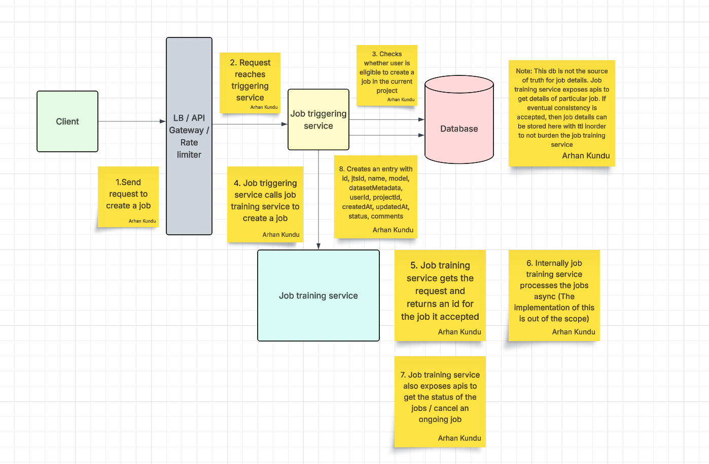

# Job Triggering Service

## Take away: 
When you have to design a component which processes requests async, the component should return an id (Which is used to correlate when the request is completed async) along with other details as a response. The component may then process the request by submitting it into a queue and a consumer may process those requests from the queue accordingly and store the results in db. Good practice to have apis exposed for getting a particular job details.

## Problem statement
You have a job training service which takes job details, model name, dataset (Already uploaded / predefined) and it triggers the jobs. You need to create a job triggering service which users would use to trigger a job.

## Functional requirements
1. User can request to trigger a job
2. User can view all the jobs that the user has triggered
3. User can view a particular job details (status like submitted, cancelled, failure, successful)
4. User can cancel a job
5. There are projects which user is assigned to and user can create jobs in the assigned projects only

## Non functional requirements
1. Low latency
2. Scalable


## Entities
1. `permissions: {userId, projectId}`
2. `jobs: {id, name, model, datasetMetadata, userId, projectId, createdAt, updatedAt, status (SUBMITTED, STARTED, SUCCESSFUL, CANCELLED, FAILED), comments}`


## API Endpoints

1. POST `jts/api/v1/jobs`
```
Request headers: access token
Request body: { name, model, datasetMetadata, projectId }
Response: { id, name, status: SUBMITTED / FAILED }
```

2. GET `jts/api/v1/jobs`
```
Request headers: access token
Response: { [id, name, status] }
```

3. GET `jts/api/v1/jobs/:jobId`
```
Request headers: access token
Response: { id, name, status, model, datasetMetadata, projectId, createdAt, updatedAt, comments }
```

4. PATCH `jts/api/v1/jobs/:jobId`
```
Request headers: access token
Request body: { action: CANCEL }
Response: { id, name, status: CANCELLING }
```


## Design




## Some points

1. The job training service exposes apis to get particular job details. Which means job training service is the source of truth.
2. If eventual consistency is accepted, the job triggering service makes a call to job training service and stores those details in databases like redis with ttl.
3. In case, we want to send notifications to user, the job training service can send the status update to the queue, the consumer would then invalidate the cache, update with new status updates and call the notification service.
