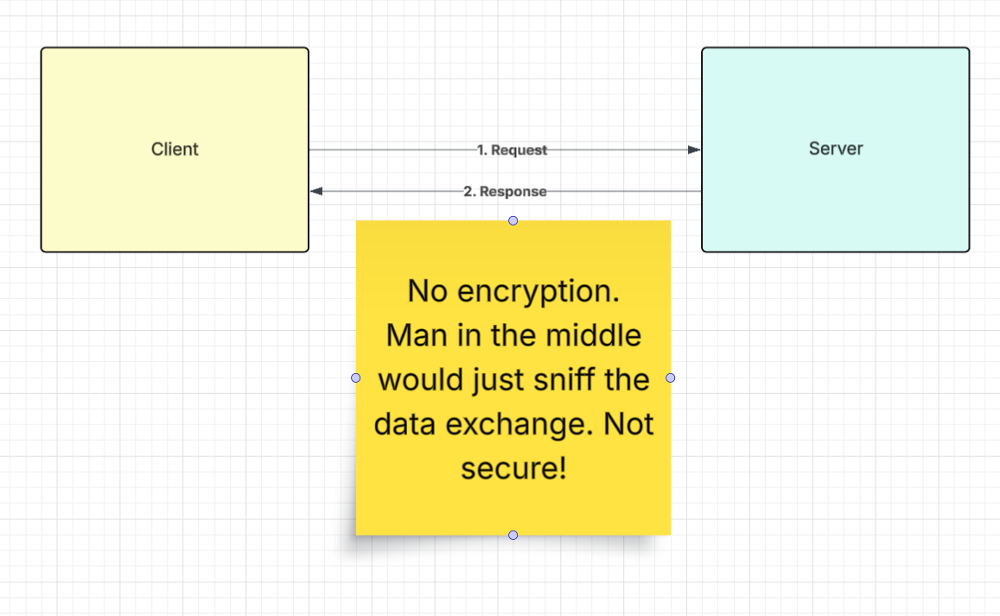
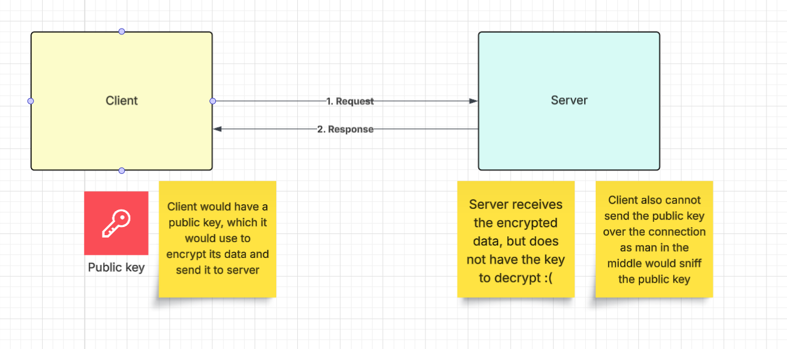
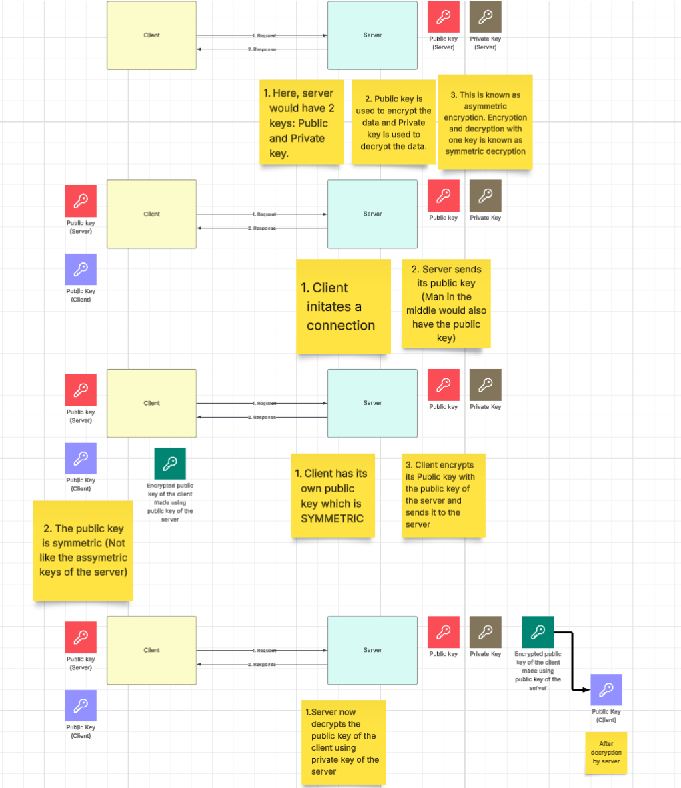
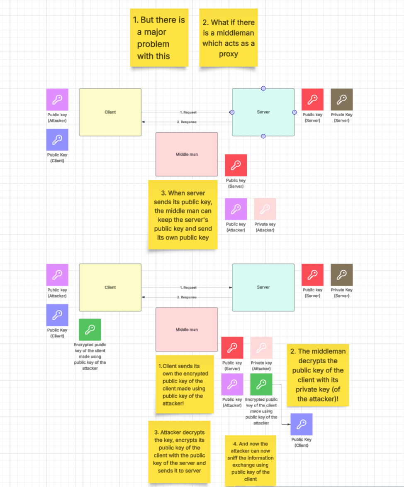
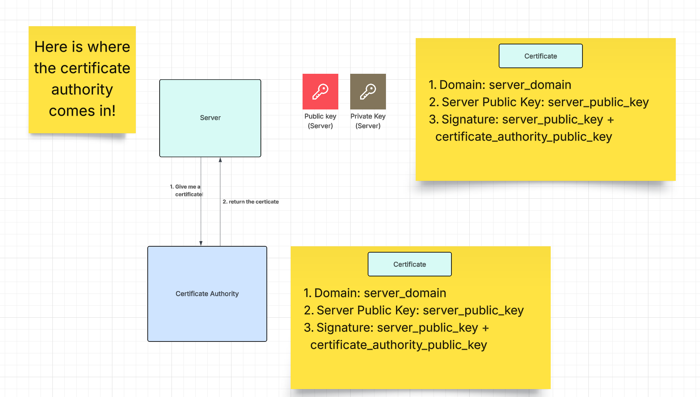
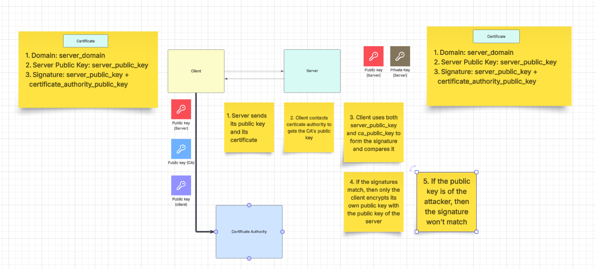
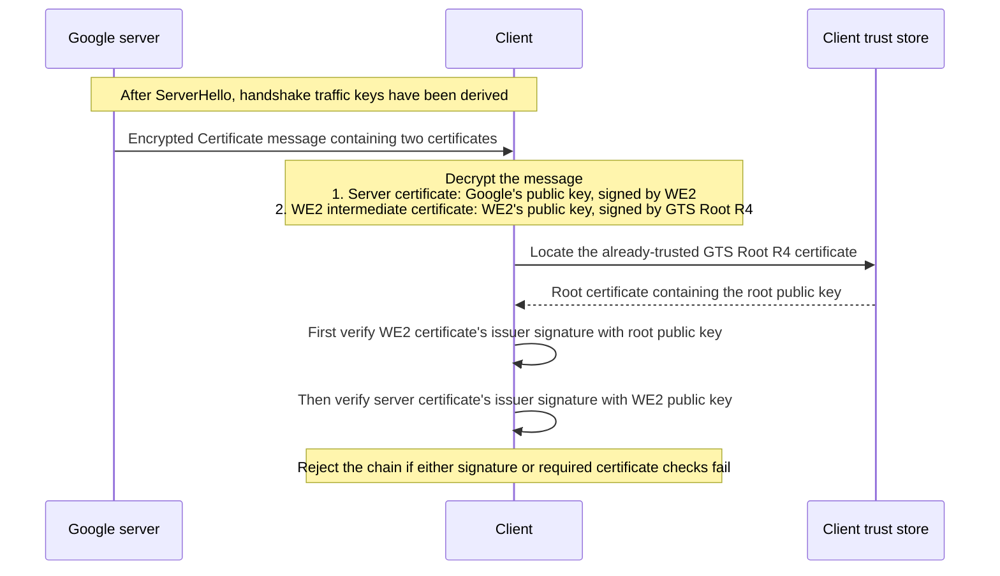
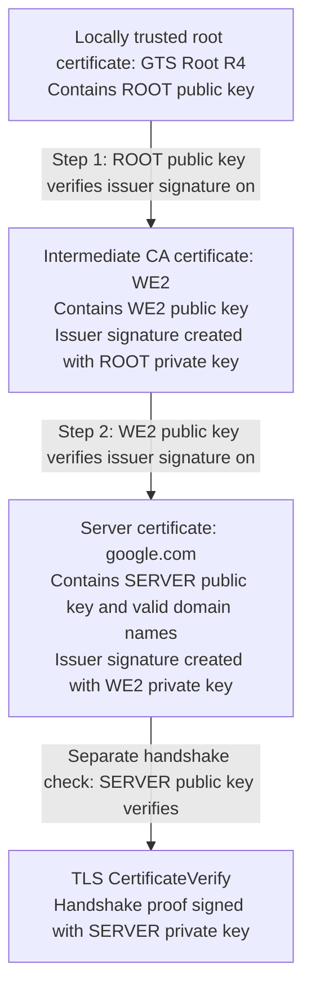

# TLS (Transport layer security)














## Internals

Use OpenSSL (Open + Secure Sockets Layer) to retrieve and inspect the TLS certificate presented by `google.com`.

## Few functions of openssl

### View a certificate
`openssl x509 -in server.crt -text -noout`

### Generate a private key
For example, an RSA key:

`openssl genpkey -algorithm RSA -out server.key -pkeyopt rsa_keygen_bits:2048`

### Extract the corresponding public key

`openssl pkey -in server.key -pubout -out server-public.pem`

### Generate a certificate signing request (CSR)

`openssl req -new -key server.key -out server.csr -addext "subjectAltName=DNS:example.com,DNS:www.example.com"`

The CSR contains the public key, requested identity information and a signature made with the private key.

<b>For a server certificate, we submit the CSR to a CA provider, such as DigiCert, GlobalSign, Sectigo, Google Trust Services or emudhra. After validation, the provider typically signs the server certificate using an intermediate CA’s private key. The intermediate CA’s own certificate is signed by its parent CA, which may be a root CA</b>

<b>Issuing an intermediate CA certificate requires a controlled CA onboarding process</b>

### Verify a certificate chain

`openssl verify -CAfile root-ca.crt -untrusted intermediate-ca.crt -purpose sslserver -verify_hostname example.com server.crt`

### Command to check the root certificates locally

`ls -1 /etc/ssl/certs/*.pem`: Lists the certificates (Specific to linux distributions)

and then use openssl command to view the local certs. Deleting these local certs may break cert validation for applications using that local store (There might be multiple local stores in our pc)

## Command

Run the following in a Bash-compatible shell with OpenSSL installed:

```bash
openssl s_client -connect google.com:443 -servername google.com </dev/null \
  | openssl x509 -text -noout
```


## Example Output

Certificate details, validity dates, and IP addresses may change over time.

```text
Connecting to 142.250.197.46
depth=2 C=US, O=Google Trust Services LLC, CN=GTS Root R4
verify return:1
depth=1 C=US, O=Google Trust Services, CN=WE2
verify return:1
depth=0 CN=*.google.com
verify return:1
DONE
Certificate:
    Data:
        Version: 3 (0x2)
        Serial Number:
            a3:5b:6b:b0:56:ef:a8:6b:10:fc:98:b4:13:f6:ef:e9
        Signature Algorithm: ecdsa-with-SHA256
        Issuer: C=US, O=Google Trust Services, CN=WE2
        Validity
            Not Before: Sep 28 18:38:33 2026 GMT
            Not After : Dec 21 18:38:32 2026 GMT
        Subject: CN=*.google.com
        Subject Public Key Info:
            Public Key Algorithm: id-ecPublicKey
                Public-Key: (256 bit)
                pub:
                    04:de:2c:4c:64:0e:8d:ea:18:d2:a5:bf:7a:39:71:
                    ae:a1:ca:9c:67:d9:f1:dd:2e:b7:a5:ae:a2:38:77:
                    5e:2b:e1:e1:38:74:0c:36:92:5d:d0:f3:3b:d5:d3:
                    06:f5:64:23:72:59:1e:81:e9:ca:82:8c:61:d4:01:
                    98:b0:f3:bd:79
                ASN1 OID: prime256v1
                NIST CURVE: P-256
        X509v3 extensions:
            X509v3 Key Usage: critical
                Digital Signature
            X509v3 Extended Key Usage:
                TLS Web Server Authentication
            X509v3 Basic Constraints: critical
                CA:FALSE
            X509v3 Subject Key Identifier:
                FA:52:16:1A:6C:61:35:F3:48:F8:FC:7B:94:40:EA:5D:E7:76:51:FF
            X509v3 Authority Key Identifier:
                75:BE:C4:77:AE:89:F6:44:37:7D:CF:B1:68:1F:1D:1A:EB:DC:34:59
            Authority Information Access:
                CA Issuers - URI:http://i.pki.goog/we2.crt
            X509v3 Subject Alternative Name:
                DNS:*.google.com, DNS:*.appengine.google.com, DNS:*.bdn.dev, DNS:*.origin-test.bdn.dev, DNS:*.cloud.google.com, DNS:*.crowdsource.google.com, DNS:*.datacompute.google.com, DNS:*.google.ca, DNS:*.google.cl, DNS:*.google.co.in, DNS:*.google.co.jp, DNS:*.google.co.uk, DNS:*.google.com.ar, DNS:*.google.com.au, DNS:*.google.com.br, DNS:*.google.com.co, DNS:*.google.com.mx, DNS:*.google.com.tr, DNS:*.google.com.vn, DNS:*.google.de, DNS:*.google.es, DNS:*.google.fr, DNS:*.google.hu, DNS:*.google.it, DNS:*.google.nl, DNS:*.google.pl, DNS:*.google.pt, DNS:*.gemini.cloud.google.com, DNS:*.gstatic.com, DNS:*.metric.gstatic.com, DNS:*.gvt1.com, DNS:*.gcpcdn.gvt1.com, DNS:*.gvt2.com, DNS:*.gcp.gvt2.com, DNS:*.url.google.com, DNS:*.youtube-nocookie.com, DNS:*.ytimg.com, DNS:ai.android, DNS:android.com, DNS:*.android.com, DNS:*.flash.android.com, DNS:g.co, DNS:*.g.co, DNS:goo.gl, DNS:www.goo.gl, DNS:google-analytics.com, DNS:*.google-analytics.com, DNS:google.com, DNS:googlecommerce.com, DNS:*.googlecommerce.com, DNS:urchin.com, DNS:*.urchin.com, DNS:youtu.be, DNS:youtube.com, DNS:*.youtube.com, DNS:music.youtube.com, DNS:*.music.youtube.com, DNS:youtubeeducation.com, DNS:*.youtubeeducation.com, DNS:youtubekids.com, DNS:*.youtubekids.com, DNS:yt.be, DNS:*.yt.be, DNS:android.clients.google.com, DNS:*.aistudio.google.com
            X509v3 Certificate Policies:
                Policy: 2.23.140.1.2.1
            X509v3 CRL Distribution Points:
                Full Name:
                  URI:http://c.pki.goog/we2/xuzt3PU9F_w.crl

            CT Precertificate SCTs:
                Signed Certificate Timestamp:
                    Version   : v1 (0x0)
                    Log ID    : D7:6D:7D:10:D1:A7:F5:77:C2:C7:E9:5F:D7:00:BF:F9:
                                82:C9:33:5A:65:E1:D0:B3:01:73:17:C0:C8:C5:69:77
                    Timestamp : Sep 28 19:38:36.358 2026 GMT
                    Extensions: none
                    Signature : ecdsa-with-SHA256
                                30:44:02:20:75:AE:95:5D:C0:D3:AD:DF:D6:55:0B:03:
                                A5:8C:9B:23:BB:86:EF:F8:32:9F:7F:45:FE:C6:46:1A:
                                20:51:1D:80:02:20:4E:68:D9:DC:A7:35:E8:C8:FF:62:
                                E1:62:D4:8D:CE:71:F6:F9:F3:50:C6:2A:AD:5E:EA:19:
                                15:2D:0D:EC:4D:63
                Signed Certificate Timestamp:
                    Version   : v1 (0x0)
                    Log ID    : C2:31:7E:57:45:19:A3:45:EE:7F:38:DE:B2:90:41:EB:
                                C7:C2:21:5A:22:BF:7F:D5:B5:AD:76:9A:D9:0E:52:CD
                    Timestamp : Sep 28 19:38:36.388 2026 GMT
                    Extensions: none
                    Signature : ecdsa-with-SHA256
                                30:45:02:21:00:A9:48:B2:DE:A6:3B:43:7C:69:1C:9E:
                                EF:16:9A:FD:55:AD:80:F0:A6:FA:23:D8:4A:AD:36:65:
                                FE:FC:7B:A3:79:02:20:1C:69:AA:A3:FA:B5:04:0F:7E:
                                B3:24:FD:6C:4E:88:0C:27:9A:1B:97:DE:72:B5:CF:9C:
                                77:B8:E9:4A:C9:81:E4
    Signature Algorithm: ecdsa-with-SHA256
    Signature Value:
        30:46:02:21:00:d0:b4:43:ab:47:01:2f:ee:1a:a1:9b:13:1c:
        2d:6b:e8:d6:23:19:a5:f0:a4:31:e9:bd:47:33:b7:b9:ed:f1:
        04:02:21:00:f0:96:0b:60:a7:fc:84:8c:2c:48:6a:95:42:ab:
        ee:21:a1:32:6f:35:5b:be:42:43:63:c0:01:b3:e8:83:43:b2
```

## Certificate Summary

A TLS certificate binds domain names to a public key, with a certificate authority's digital signature backing that binding.

| Information | What it tells you | Example from the Google certificate below |
|---|---|---|
| **Issuer** | Which certificate authority issued it, including its country, organization, and name. | `C=US` (United States), `O=Google Trust Services`, `CN=WE2`. WE2 is the name of the intermediate certificate authority operated by Google trust services |
| **Validity** | The time window when the certificate can be accepted. | **Not Before:** `Sep 28 18:38:33 2026 GMT`; **Not After:** `Dec 21 18:38:32 2026 GMT`. |
| **Server's public key** | Public key of the server | A 256-bit elliptic-curve key using `P-256` (also called `prime256v1`); the public-key bytes under `pub` begin `04:de:2c:4c:64:0e:8d:ea:...`. |
| **Valid domain names** | Which website names the certificate covers, listed under **Subject Alternative Name (SAN)**. | Includes `google.com`, `*.google.com`, `youtube.com`, and `*.youtube.com`, among others. |
| **Issuer's digital signature** | The intermediate CA creates a sign with the hash of the contents of the certificate and the private key of the intermediate CA | **Signature Algorithm:** `ecdsa-with-SHA256`; the final **Signature Value** begins `30:46:02:21:00:d0:b4:43:...`. |

A wildcard such as `*.google.com` covers `www.google.com`, but not `google.com` itself or `a.b.google.com`. The base domain `google.com` is listed separately.

## How Signing and Verification Work

**WE2 (The intermediate CA) creates the signature; our computer checks it.** Both calculate a hash, but only WE2 uses its private key to sign.


### 1. WE2 (Intermediate CA) Signs the Certificate

```text
Hash(TBSCertificate) -> H1
Sign(WE2_PRIVATE_KEY, H1) -> SIGNATURE

TBS stands for To be signed. It contains the subject, public key, validity, list of supported domains etc
```

- **`Hash(...)`** calculates a digital fingerprint of the contents. `H1` is just a name for that fingerprint.
- **`Sign(...)`** uses WE2's private key and `H1` to create a signature.
- WE2 attaches that signature to the certificate. Its private key stays secret.

In this certificate, `ecdsa-with-SHA256` means the signature uses ECDSA with SHA-256 hashing.

### 2. Our Computer Verifies the Signature

```text
Hash(received certificate contents) -> H2
Verify(WE2_PUBLIC_KEY, H2, SIGNATURE) -> VALID or INVALID
```

- Our computer receives Google's certificate and its attached signature.
- It calculates its own fingerprint, called **`H2`**, using the same hash algorithm.
- It obtains **WE2's public key** from WE2's own CA certificate.
- **`Verify(...)`** mathematically checks whether the attached signature fits both `H2` and WE2's public key.

This basically checks whether the server certificate has been tampered or not. If the verify function suceeds, then the certificate has not been tampered.


## TLS 1.3: Flow Between Client and Server

### 1. Client Sends ClientHello

The browser connecting to `google.com` effectively says:

> "I support TLS 1.3, these cipher suites, and these key-exchange groups. Here is my temporary public key share: A."

The client keeps its matching temporary private key secret. 


`KEY EXCHANGE GROUP`: A key-exchange group defines the mathematical rules used to calculate the shared secret; `X25519` is a common example.

`CIPHER SUIT`: Example `TLS_AES_128_GCM_SHA256`.

(a) Used to generate multiple keys for 
1. Client -> Server handshake messages
2. Server -> Client handshake messages
3. Client -> Server application data
4. Server -> Client application data

(b) Encryption algorithms require a specific key size. For example, AES-128 needs a 128-bit key. A key exchange such as X25519 produces a 32-byte shared secret.

### 2. Server Sends ServerHello

The server effectively replies:

> "Let's use TLS 1.3, this cipher suite, and this key-exchange group. Here is my temporary public key share: B."

The server keeps its matching temporary private key secret. Both sides can now calculate the same shared secret:

```text
Client: client's temporary private key + server's public share B -> shared secret
Server: server's temporary private key + client's public share A -> same shared secret
```

Here, `+` means "used together in the key-agreement calculation," not ordinary addition.

### 3. Server Sends Its Certificate, Proof, and Finished

After `ServerHello`, the server sends these encrypted handshake messages:

| Message | Purpose |
|---|---|
| **Certificate** | Supplies the server certificate and intermediate certificates needed to help build its trust chain. |
| **CertificateVerify** | Signs the handshake transcript, with TLS-specific context, using the private key corresponding to the server certificate. |
| **Finished** |  |

The transcript is the record of handshake messages exchanged so far, including the hello messages and their public key shares.

The client validates the certificate chain to a trusted root, checks that the certificate covers `google.com`, checks its dates and permitted uses, and applies its revocation policy. It then uses the **server public key in the certificate** to verify `CertificateVerify`, and verifies the server's `Finished`.


### 4. Client Sends Finished, Then Requests

After those checks succeed, the client sends its own encrypted `Finished`. The server verifies it.

Both sides also derive **application traffic keys**, separate from the handshake traffic keys. The client can send an encrypted HTTP request, and the server can send an encrypted response.

```text
CLIENT                                         SERVER
   | -------- ClientHello (public share A) ------> |
   | <------- ServerHello (public share B) ------- |
   |                                              |
   |       Both derive handshake traffic keys     |
   |                                              |
   | <------- EncryptedExtensions ---------------- |
   | <------- Certificate ------------------------ |
   | <------- CertificateVerify ------------------ |
   | <------- Finished --------------------------- |
   |                                              |
   | Client validates certificate, handshake      |
   | signature, and server Finished               |
   |                                              |
   | -------- Finished -------------------------> |
   | -------- Encrypted HTTP request -----------> |
   | <------- Encrypted HTTP response ------------ |
```

All messages shown after `ServerHello` are encrypted.

## Sending and Verifying the Certificate Chain

This example assumes one intermediate CA: **GTS Root R4 -> WE2 -> Google server certificate**. The server sends two certificates; the root certificate is normally already in the client's trust store and is not sent.

### 1. Server Sends Two Certificates



### 2. Which Public Key Verifies Which Certificate?

The arrows below show the direction of verification, not the order in which certificates are sent.



### Toy Example: Agree on a Secret Without Sending It

These tiny numbers are **insecure and for explanation only**, not actual parameters. Real TLS uses strong cryptographic groups, often elliptic curves.

For this classic Diffie-Hellman example, both sides know the public parameters `p = 23` and `g = 5`.

| Step | Browser | Server |
|---|---|---|
| Choose a temporary private value. | `a = 6` | `b = 15` |
| Calculate a public share. | `A = 5^6 mod 23 = 8` | `B = 5^15 mod 23 = 19` |
| Send the public share, keeping the private value secret. | Sends `8`. | Sends `19`. |
| Calculate the secret using the received share. | `B^a mod 23 = 19^6 mod 23 = 2` | `A^b mod 23 = 8^15 mod 23 = 2` |

Both arrive at **`2`**, but neither sends `2`. This works because:

```text
B^a mod p = (g^b)^a mod p = g^(ab) mod p
A^b mod p = (g^a)^b mod p = g^(ab) mod p
```

## Why CertificateVerify Is Necessary

**A certificate is public: anyone can copy it. CertificateVerify proves that the server holds the private key matching that certificate.**

### 1. The Certificate Identifies a Public Key

For eg., Google's certificate contains the following simplified information:

```text
Domain: google.com
Server public key: GOOGLE_PUBLIC_KEY
Issuer: WE2
Issuer's signature: ...
```

After validating the certificate, our browser knows:

> "A trusted authority has certified that this public key belongs to google.com."

But that does not prove the server presenting the certificate holds Google's private key. An attacker could present an exact copy of the same certificate because this is a public certificate.

### 2. The Server Proves It Holds the Matching Private Key

During the handshake, the browser and server exchange messages such as:

```text
Browser: Here is my temporary public key share A.
Server:  Here is my temporary public key share B.
Server:  Here is my certificate.
```

The handshake transcript records the messages exchanged so far, including those key shares. Google's server creates a signature over a proof input containing a hash of that transcript and TLS-specific context using the private key of the server.

```text
Sign(GOOGLE_PRIVATE_KEY, handshake proof input)
    -> CertificateVerify signature
```


### 3. The Browser Checks the Proof

The browser constructs the proof input from its own handshake transcript and checks the signature using Google's public key from the validated certificate:

```text
Verify(GOOGLE_PUBLIC_KEY, handshake proof input, received signature)
    -> VALID or INVALID
```

| Example | What the server or attacker sends | What the browser checks | Result |
|---|---|---|---|
| **A: Real Google server** | Google's certificate and a signature made using `GOOGLE_PRIVATE_KEY` for this handshake. | The signature against this handshake's proof input using `GOOGLE_PUBLIC_KEY`. | **Valid** |
| **B: Attacker copies Google's certificate** | Google's certificate, but a signature made using `ATTACKER_PRIVATE_KEY`. | The signature using `GOOGLE_PUBLIC_KEY`, not the attacker's public key. | **Invalid**|

## Case Study: eMudhra CA Key Compromise (October 2026)

### What Happened?

eMudhra operates the **emSign** certificate authority service. In October 2026, researchers reported that the private keys associated with **eight intermediate CA certificates** were compromised.

According to the public incident disclosure, the keys had been generated incorrectly, making them recoverable from public certificate information. These were CA signing keys, not ordinary website keys: possession of an affected key could allow an attacker to sign fraudulent website certificates.

**A CA private key endorses identities. Compromising it can affect many domains, not just one website.**

### Example: Why Both Signature Checks Could Pass

Suppose an attacker obtains one of the compromised CA private keys and creates their own server key pair:

```text
ATTACKER_SERVER_PUBLIC_KEY
ATTACKER_SERVER_PRIVATE_KEY
```

They create a fraudulent certificate claiming:

```text
Domain: google.com
Server public key: ATTACKER_SERVER_PUBLIC_KEY
Issuer signature: created using the compromised CA private key
```

If the victim's client still accepts the affected CA chain and the fraudulent certificate passes its other checks:

| Check | Key used to create the signature | Key the client uses to verify it | Why verification could pass |
|---|---|---|---|
| **Certificate's issuer signature** | Compromised eMudhra CA private key. | The corresponding CA public key. | The signature is mathematically valid, even though the certificate was issued fraudulently. |
| **CertificateVerify** | Attacker's server private key. | Attacker's server public key from the fraudulent certificate. | The attacker really holds the private key matching the presented certificate and can sign this handshake. |

**These are two different private keys.** The compromised CA key signs the fraudulent certificate; the attacker's server key signs `CertificateVerify`. Google's real private key is not needed.

`CertificateVerify` still does its job: it proves possession of the private key matching the certificate. **The failure is the CA's false endorsement that this public key belongs to `google.com`.**


### What Happens to the Traffic?

If the attacker can intercept or redirect the victim's connection and the client accepts the fraudulent identity, the client establishes an encrypted connection with the attacker.

The attacker could also open a separate connection to the real website:

```text
Browser <-- encrypted connection 1 --> Attacker <-- encrypted connection 2 --> Google
```

The attacker participates in both key exchanges and therefore knows the secrets for both connections. They could read or change messages before re-encrypting and forwarding them.

**The encryption has not been broken. The client has encrypted its information for the wrong recipient.**

### Response and Limits

- Mozilla reports receiving the disclosure on **October 17, 2026**, and distributing an initial Firefox block through OneCRL in **less than three hours**.
- Browser vendors and other trust-store maintainers blocked affected certificates or released updates.

Sources:

- [Mozilla: Protecting Firefox users following the compromise of eMudhra intermediate certificates](https://blog.mozilla.org/security/2026/10/20/protecting-firefox-users-following-the-compromise-of-emudhra-intermediate-certificates/)
- [Public incident disclosure: eMudhra Intermediate CA Compromise](https://emudhra.we-have-a-problem.com/)
